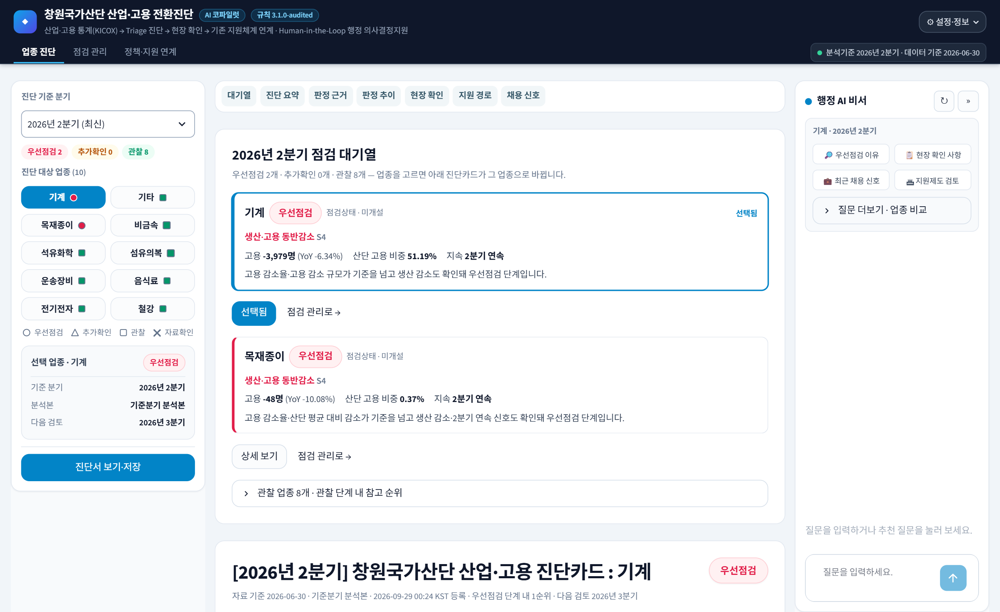
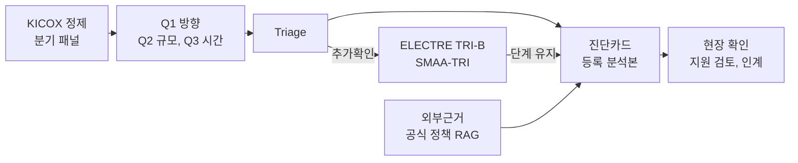
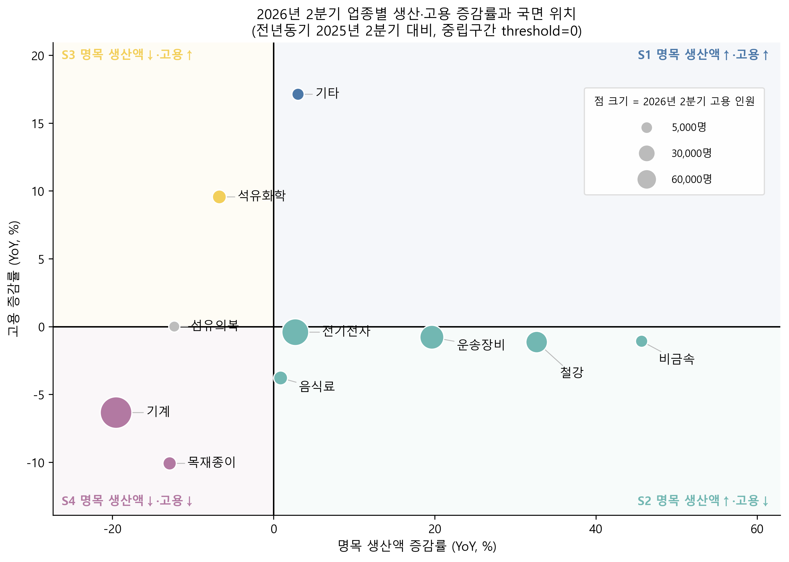
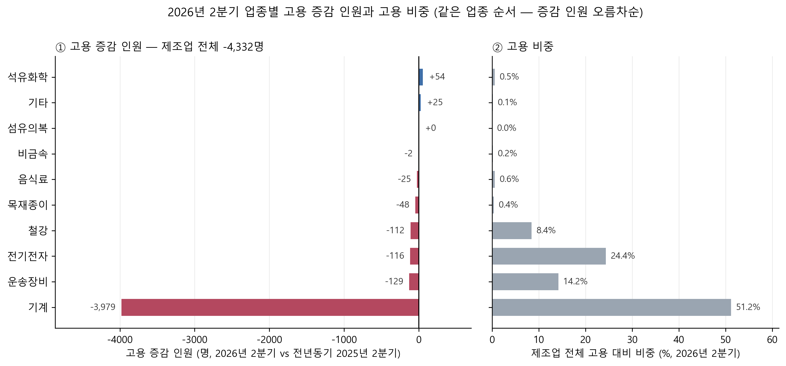
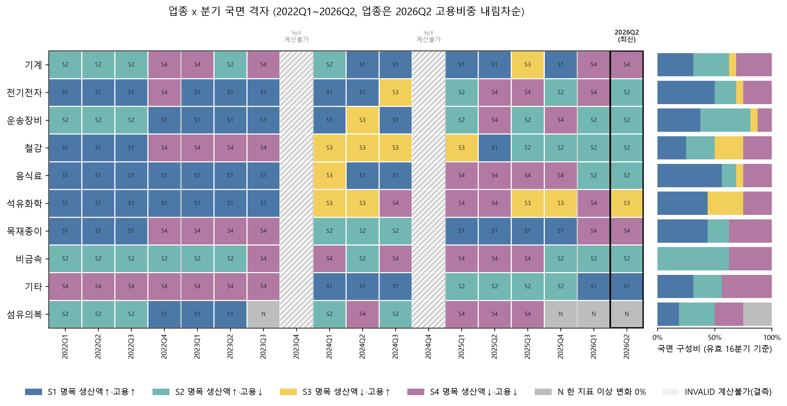
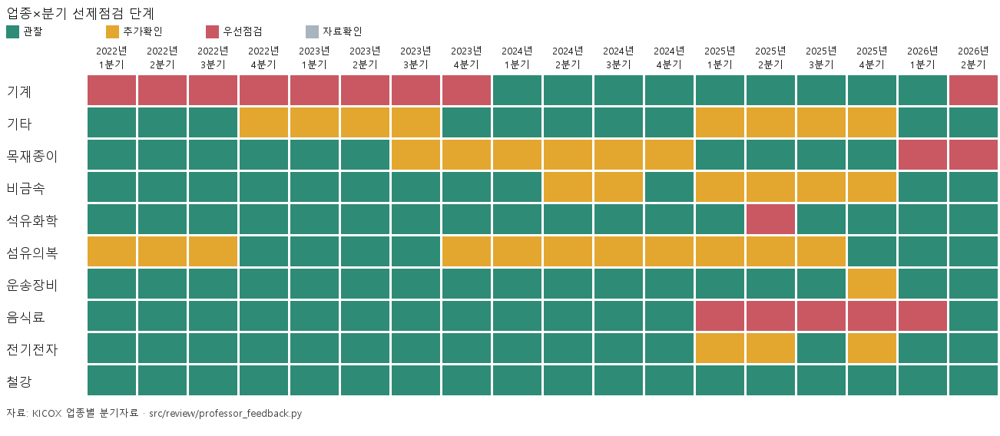

# Changwon Industry and Employment Monitor

## Overview

창원국가산단의 **업종별 생산, 고용 변화**를 분석하는 시스템. 분산된 산업, 고용 자료를 모아 점검 우선순위, 현장 확인, 기업지원과 고용지원, 직업훈련 검토로 연결.

      

[앱 열기](https://changwon-industry-employment-monitor-public.streamlit.app/)

<p align="center">
  
</p>
<p align="center"><sub>2026년 2분기 등록 분석본. 점검 대기열, 업종 진단카드, 행정 AI 비서 화면.</sub></p>

## Data

| Data | Scope | Role |
|---|---|---|
| KICOX 생산, 고용 | 원자료 2018Q1–2026Q2, 창원국가산단 업종별 분기 자료 | 국면과 점검 단계 계산 |
| 최종 분석 패널 | 2022Q1–2026Q2, 10개 업종 × 18분기 = **180행** | Q1–Q3, Triage 분석 |
| PPI, EIS | PPI 2021.01–2026.06, EIS 2022Q1–2026Q2 | 가격효과와 고용 방향 교차확인 |
| 수출입, 전력, 가동률, 경기심리 | 자료별 지역, 업종, 기간 상이 | 현장 확인을 위한 맥락 자료 |
| 고용24 공개 채용정보 | 2026년 9월 수집 단면의 집계 | 과거 수집 범위 참고 및 가상 공고 화면 예시 |
| 공식 정책, 기관 문서 | 공식 HTML, PDF, 기업마당 공고 조회 | 지원제도와 접수 경로 탐색 |

- **원자료, 실제 공고 단위 자료, API 키**는 로컬에 보관합니다. 공개 앱의 채용공고는 화면 시연용 가상 데이터입니다. 출처와 입력 경로는 [Data 안내](data/README.md)를 참고하세요.
- 자동 판정에는 **KICOX 생산, 고용 지표만 사용**. 외부자료와 AI 답변은 판정을 변경하지 않음.

## Research Design

1. **분기별 생산과 고용 자료 정제**

   - KICOX 원자료와 연간보정본을 반영해 업종별 패널 구성. 비교할 수 없는 생산값은 보간하지 않고 결측으로 표시.

2. **방향, 규모, 지속기간을 나누어 분석**

   - **Q1**: 명목 생산과 고용의 전년동기 대비 증감 방향으로 국면 구분.
   - **Q2**: 고용 증감 인원, 고용 비중, 전체 변화 기여 계산.
   - **Q3**: 동일 국면의 지속기간과 인접 분기 전환 확인. 결측 분기를 건너 연결하지 않음.

3. **Triage 규칙으로 점검 단계 구분**

   - 고용감소율, 산단 평균 대비 열위, 감소 인원의 산단 고용 대비 규모에 생산감소와 반복신호를 결합.
   - **관찰, 추가확인, 우선점검**으로 구분. 우선점검에는 고용 300인 이상 조건 적용. 경계값은 법정 위기 기준이 아닌 점검 운영규칙.
   - 추가확인 35행만 **ELECTRE TRI-B / SMAA-TRI**로 재검토. 여러 지표와 경계 설정에 따른 분류 안정성을 비교하며 원래 Triage 단계는 유지.

4. **외부근거와 RAG로 확인 질문 구체화**

   - PPI, EIS 등은 범위와 매핑 품질을 표시해 교차확인.
   - **RAG**로 공식 정책 문서를 검색해 답변 근거로 사용. Gemini로 검색 근거를 설명, 요약.
   - 사업 제안과 현재 시행 중인 공식 사업은 구분.

5. **등록 분석본을 점검과 인계에 연결**

   - Streamlit에서 진단 근거를 확인하고 현장 확인, 지원 검토, 인계, 다음 검토 분기를 기록.
   - 앱은 등록된 분석본을 읽으며 분석을 재계산하지 않음.

## Analysis Workflow



## Key Results

### Q1. Production and Employment

- **2026Q2 고용 감소 7개 업종 중 5개는 명목 생산 증가**. 고용 변화만으로 산업활동의 방향을 설명하기 어려움.

<p align="center">
  
</p>
<p align="center"><sub>2026Q2 생산, 고용 YoY(%). 점 크기는 고용 인원. 생산은 물가를 제거하지 않은 명목값.</sub></p>

### Q2. Employment Scale

- 제조업 고용은 전년동기 대비 **4,332명 감소**, 기계 업종은 **3,979명 감소**.
- 기계의 직전 분기 대비 감소는 **104명**. 전년동기 대비 감소 규모와 최근 변화의 완화를 함께 확인할 필요가 있음.

<p align="center">
  
</p>
<p align="center"><sub>2026Q2 고용의 전년동기 대비 증감 인원과 산단 제조업 고용 비중.</sub></p>

### Q3. State Changes

- **동일 국면의 지속과 인접 분기 전환**을 분석. 10개 업종의 18분기 흐름을 비교해 최근 상태가 반복되는지, 달라졌는지 확인.
- 생산, 고용 방향을 나타내는 S1–S4에는 위험 순위가 없음. 결측 분기를 건너 지속기간이나 전환을 연결하지 않음.

<p align="center">
  
</p>
<p align="center"><sub>2022Q1–2026Q2 국면 격자. 빗금은 YoY 계산 불가 구간. 과거의 국면 구성과 전환이며 미래 예측확률이 아님.</sub></p>

### Triage. Inspection Priorities

| Scope | 관찰 | 추가확인 | 우선점검 |
|---|---:|---:|---:|
| 전체 180개 업종-분기 | 128 | 35 | 17 |
| 2026Q2, 10개 업종 | 8 | 0 | 2 |

- 2026Q2 우선점검은 **기계, 목재종이**. 기업별 위기 여부나 지원대상 확정을 뜻하지 않음.
- **기계**의 우선점검 단계는 규모 지표의 경계 설정에 민감함. **목재종이**는 전년동기 고용 476명에서 48명 감소한 사례로, 1명 차이에도 고용감소율 10% 경계 통과 여부가 달라짐.

<p align="center">
  
</p>
<p align="center"><sub>2022Q1–2026Q2, 10개 업종의 점검 단계. 2026Q2 우선점검은 기계와 목재종이. 색은 운영규칙에 따른 점검 단계이며 위기확률이 아님.</sub></p>

## Limitations

- 업종 단위 동반변화는 **인과관계나 개별 기업의 위기**를 뜻하지 않음. 점검 단계는 운영 경계값과 규모 조건에 따라 달라짐.
- **점검 우선순위 산정용**이며 미래 위기 예측이나 현장 정책효과를 입증한 결과는 아님.
- 명목 생산의 가격효과, 원자료 개정과 공표 시차를 고려해야 함. 외부자료는 모집단과 업종 매핑이 달라 직접 합산하거나 대체할 수 없음.
- 공개 채용공고는 전체 노동수요나 미충원 규모를 대표하지 않음. RAG와 AI 답변도 담당자 판단을 대체하지 않음.
- **공개 앱은 인증 미연결 프로토타입**. 실제 개인정보와 기업 비공개정보 입력 제외. 로컬 SQLite 기록은 배포 환경에서 영구 보존을 보장하지 않음.

## Repository Structure

```text
├── src/         # 분석, 근거 검색, Streamlit, 점검 기록
├── notebooks/   # 단계별 분석과 최종 결과
├── data/        # 가공 패널과 분류 대응표
├── outputs/     # 최종 결과표와 그림
├── snapshots/   # 앱에서 읽는 등록 분석본
├── LLM/         # 정책 원문과 검색 근거
├── reports/     # 방법론과 상세 결과
├── logs/        # 현재 분석이 참조하는 비교 코드와 저장 결과
└── assets/      # 앱 화면 이미지
```

[실행 및 코드 안내](src/README.md), [Notebook 안내](notebooks/README.md), [결과 안내](outputs/final_model/README.md), [상세 문서](reports/README.md)
